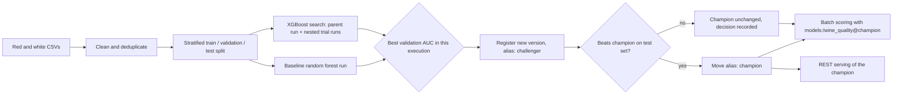
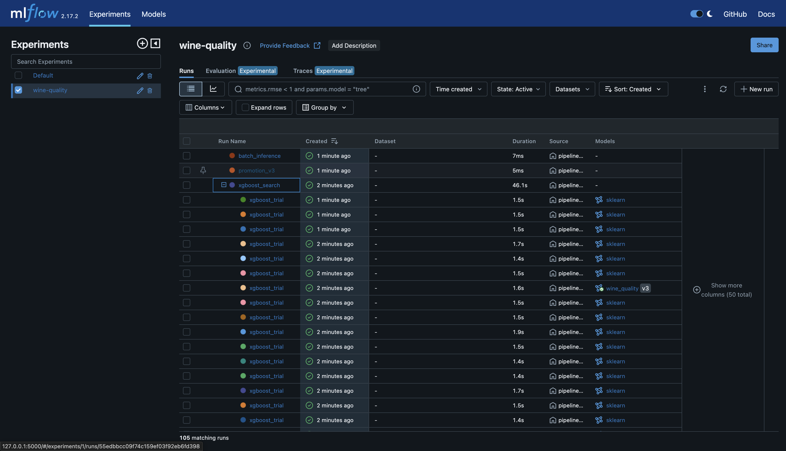
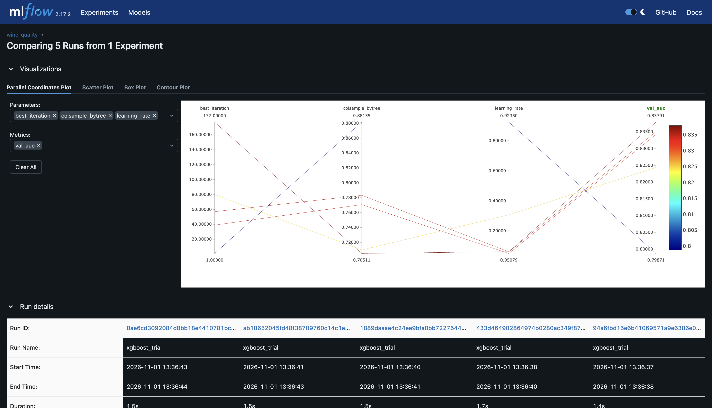
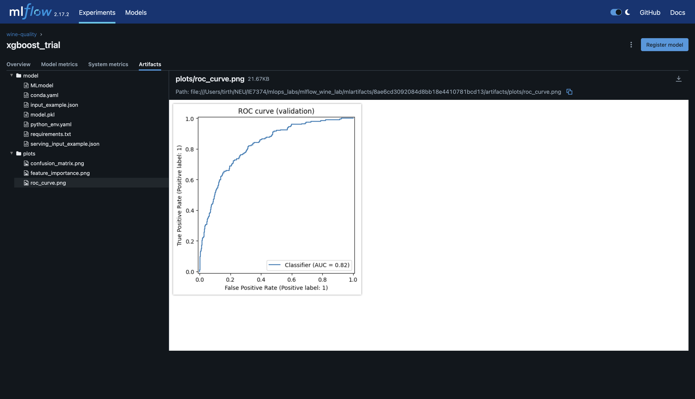
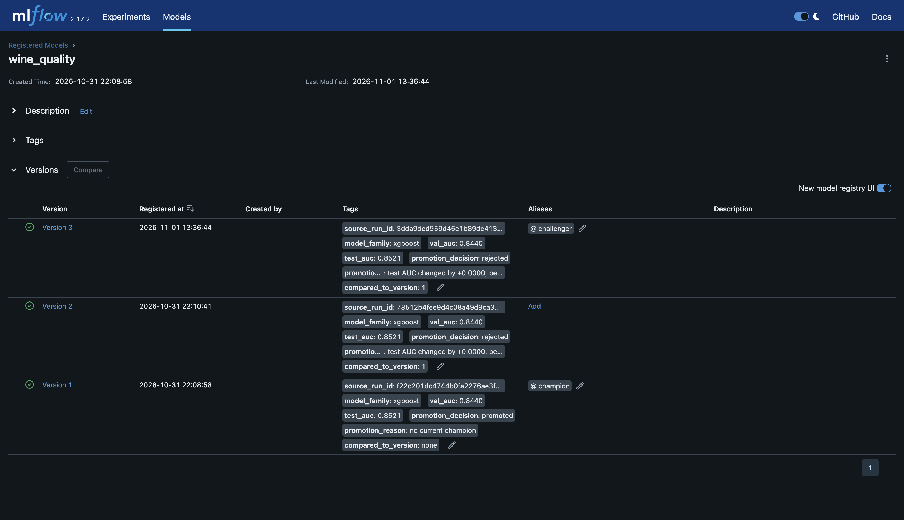
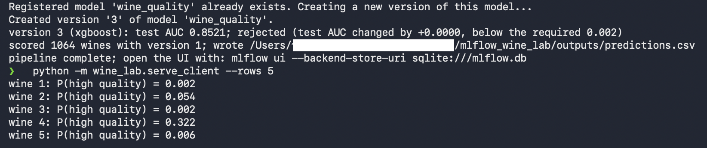

# MLflow Lab: Experiment Tracking and Model Registry for Wine Quality

Author: Tirth Borasaniya, IE-7374 MLOps

Based on `Labs/Experiment_Tracking_Labs/Mlflow_Labs/Lab2` from the IE-7374 MLOps course repository. The original lab is a notebook, adapted from a Databricks tutorial, that trains a random forest and an XGBoost hyperparameter search on the Wine Quality dataset, tracks them with MLflow, registers the best model, and serves it. This version rebuilds that workflow so it runs on a laptop, fixes the bugs that stop it from working with current MLflow, and extends the tracking and registry parts.

**Contents:** [Changes to the core concept](#changes-to-the-core-concept) · [Bugs fixed](#bugs-fixed-from-the-original-lab) · [Prerequisites](#prerequisites) · [Setup](#setup) · [Running the lab](#running-the-lab) · [What a successful run looks like](#what-a-successful-run-looks-like) · [Troubleshooting](#troubleshooting) · [Results](#results) · [Project structure](#project-structure)

## How it works



Every step is recorded in MLflow: the data preparation, each candidate model, the search, the promotion decision, and each batch scoring job.

## Changes to the core concept

The lab's core concept is experiment tracking and the model registry. The changes are in that code, not only in the data or model:

### 1. Organized, reproducible tracking (`wine_lab/tracking.py`, `wine_lab/train.py`)
- **A named experiment** (`wine-quality`) with a SQLite backend and a fixed artifact folder, instead of the default experiment in whatever folder the notebook happened to run in.
- **Datasets logged as MLflow inputs:** each split (train, validation, test) is attached to the data run with `mlflow.log_input`, so the UI shows exactly which data a run used.
- **A data preparation run** records the raw row count, duplicates removed, rows used, positive rate, threshold, split fraction, and seed.
- **Every candidate is tagged** with its model family and the ID of the execution that produced it.

### 2. Fair, leak-free model comparison (`wine_lab/data.py`, `wine_lab/evaluation.py`)
- **Duplicates removed before splitting.** The dataset contains 1,177 exact duplicate rows out of 6,497; the original split them randomly, so the same wine could appear in both training and test data, inflating every score. The data run logs how many were removed.
- **Stratified splits**, so the roughly 20 percent of high-quality wines is spread evenly across the train, validation, and test sets.
- **One yardstick for every candidate:** all models are scored on the same validation set. The test set is touched only once, when deciding whether to promote.
- **Richer logging per candidate:** AUC, average precision, log loss, accuracy, precision, recall, and F1, plus a ROC curve, a confusion matrix, and a feature importance chart as artifacts.

### 3. Hyperparameter search that runs locally (`wine_lab/train.py`)
- Hyperopt with local `Trials` instead of `SparkTrials`, so no Spark or Java is needed.
- Each trial is a nested run under one `xgboost_search` parent run, which records the best parameters, best validation AUC, and number of trials.
- XGBoost stops early on the validation set, and each model is logged exactly once.
- All candidates, random forest and XGBoost alike, are logged under the same artifact path with a signature and input example, so any of them can be registered and served the same way.

### 4. Model registry with aliases and a promotion gate (`wine_lab/promote.py`, `wine_lab/decisions.py`)
- **Aliases instead of stages:** current MLflow replaces the deprecated `Production` and `Archived` stages with aliases. The newest registered version gets `challenger`, and the deployed version holds `champion`.
- **A promotion gate:** the challenger replaces the champion only if its test AUC is higher by at least 0.002. Re-running the pipeline therefore never replaces a good model with an equal or worse one.
- **Decisions recorded on the model version:** each version is tagged with its source run, model family, validation AUC, test AUC, decision, reason, and the version it was compared against. A `promotion_vN` run logs both test scores.

### 5. Batch inference and serving by alias (`wine_lab/batch_predict.py`, `wine_lab/serve.py`, `wine_lab/serve_client.py`)
- **Batch scoring with pandas**, loading `models:/wine_quality@champion`, in place of the original Spark step that never ran. Each batch is logged as a `batch_inference` run with the model version used, row count, mean probability, and predicted high-quality rate, and the predictions CSV is attached as an artifact.
- **REST serving of the champion** through `mlflow models serve`, wrapped in a script so it works the same on macOS, Linux, and Windows, plus a client that sends real rows.

### Also changed
- The notebook is replaced by modules with one command per step and one command for the whole pipeline.
- **CI** (`.github/workflows/ci.yml`): on every push, GitHub Actions lints the code, runs the unit tests, runs the full pipeline twice (the second run checks the gate against an existing champion), checks the registry and predictions, then starts the model server and queries it.

## Bugs fixed from the original lab

| Problem in the original | Fix |
| --- | --- |
| The baseline's AUC is computed on the **test** set but XGBoost's on the **validation** set, and `search_runs(order_by=['metrics.auc DESC'])` then picks the "best" across both | Every candidate is scored on the validation set; the test set is used only for the promotion decision |
| If the random forest wins that comparison, `register_model(f"runs:/{id}/model")` fails, because the forest was logged under `random_forest_model` | All candidates are logged under the same artifact path, `model` |
| `search_runs` with no filters can pick parent runs, runs from earlier executions, or runs from other experiments | Candidates are found by tag and execution ID in the lab's own experiment |
| `transition_model_version_stage` and `models:/wine_quality/production` use registry stages, deprecated in current MLflow | Aliases (`champion`, `challenger`) and `models:/wine_quality@champion` |
| `SparkTrials` and the batch step require PySpark and Java; the batch step also uses an undefined `table_path` and cannot run | Local Hyperopt trials and pandas batch scoring |
| `mlflow.xgboost.autolog()` and a manual `log_model` both log each XGBoost model | Each model is logged once |
| Duplicate rows are split across train and test, inflating scores | Duplicates removed before splitting |
| The red file is read with commas and the white file with semicolons; a fresh copy of the public dataset (semicolons for both) loads the red data into a single column | The separator is detected automatically for each file |
| `sns.distplot` has been removed from seaborn, and `_mlflow_conda_env` is a private MLflow function | Neither is used |
| `requirements.txt` leaves `mlflow` unpinned, so a fresh install gets a version the notebook's registry calls are deprecated in, and includes `pyspark` | Every dependency pinned to a tested version; no Spark |

## Prerequisites

Everything runs on your own computer; no cloud account is needed.

| Software | Version | How to get it |
| --- | --- | --- |
| Python | **3.11** (tested; 3.10 to 3.12 should also work). **3.13 is not supported**: some pinned packages do not install on it | https://www.python.org/downloads/ ; on Windows, tick "Add Python to PATH" during installation. Or use conda, see Setup |
| Git | Any recent version | https://git-scm.com/downloads |
| Python packages | Pinned in `requirements.txt`: MLflow 2.17.2, XGBoost 2.1.1, Hyperopt 0.2.7, scikit-learn 1.5.2, pandas 2.2.3, NumPy 1.26.4. Also `setuptools<81` (Hyperopt and MLflow 2.17 import `pkg_resources`, which newer setuptools removed) and `SQLAlchemy==2.0.36` (MLflow 2.17's database layer fails with newer SQLAlchemy) | Installed in the setup step below |

Check the installs in a terminal (Terminal on macOS, PowerShell on Windows):

```bash
python3 --version     # Windows: python --version
git --version
```

About 1 GB of free disk space is enough for the packages and MLflow's files.

## Setup

Download the code:

```bash
git clone https://github.com/TirthBorasaniya/mlflow_wine_lab.git
cd mlflow_wine_lab
```

Then create an environment with **one** of these options.

**Option A: Python 3.11 installed directly**

```bash
python3.11 -m venv mlflow_lab_env           # Windows: py -3.11 -m venv mlflow_lab_env
source mlflow_lab_env/bin/activate          # Windows: mlflow_lab_env\Scripts\activate
pip install -r requirements-dev.txt
```

**Option B: conda** (use this if your default Python is 3.13 or you already have Anaconda or Miniconda)

```bash
conda create -n mlflow-lab python=3.11 -y
conda activate mlflow-lab
pip install -r requirements-dev.txt
```

The terminal prompt now starts with `(mlflow_lab_env)` or `(mlflow-lab)`. The data files are already in `data/`.

**Every new terminal** you open for this lab needs the environment activated and the repository folder selected before running commands, for example `conda activate mlflow-lab` followed by `cd mlflow_wine_lab`.

## Running the lab

Run every command from the repository folder with the environment activated.

**1. Run the whole pipeline** (about 2 to 5 minutes):

```bash
python -m wine_lab.pipeline --max-evals 30
```

This trains the baseline and 30 XGBoost trials, registers the best model, applies the promotion gate, and scores the batch file. The steps can also be run one at a time with `python -m wine_lab.train`, `python -m wine_lab.promote`, and `python -m wine_lab.batch_predict`.

**2. Open the MLflow UI** in a second terminal (activate the environment there too):

```bash
mlflow ui --backend-store-uri sqlite:///mlflow.db --port 5000
```

Open http://127.0.0.1:5000. Select the `wine-quality` experiment to see the runs, and **Models** at the top for the registry.

**3. Serve the champion model** in another terminal:

```bash
python -m wine_lab.serve
```

Leave it running, then in another terminal:

```bash
python -m wine_lab.serve_client --rows 5
```

**4. See the promotion gate work:** run the pipeline again. A new version is registered as `challenger`, but `champion` only moves if the new model is clearly better.

```bash
python -m wine_lab.pipeline --max-evals 30
```

**5. Run the tests** (optional):

```bash
pytest
flake8 wine_lab tests --max-line-length 100
```

To start over, stop the UI and server, then delete `mlflow.db`, `mlartifacts/`, and `outputs/`.

## What a successful run looks like

**The pipeline** prints one line per step, ending with:

```
data: 6497 rows, 1177 duplicates removed, 5320 used
baseline random forest: validation AUC 0.8...
xgboost search (30 trials): best validation AUC 0.8...
version 1 (xgboost): test AUC 0.8...; promoted (no current champion)
scored 1064 wines with version 1; wrote .../outputs/predictions.csv
pipeline complete; open the UI with: mlflow ui --backend-store-uri sqlite:///mlflow.db
```

Exact AUC values depend on library versions and the search; values between roughly 0.80 and 0.92 are normal, and the best model may be the random forest or an XGBoost trial. On the **second** run, the version line ends with either `promoted (test AUC improved by ...)` or `rejected (test AUC changed by ..., below the required 0.002)`, and the batch line names whichever version is champion.

**The MLflow UI** shows, in the `wine-quality` experiment:
- A `data_preparation` run with the duplicate count and the three datasets under **Datasets used**
- `baseline_random_forest`, and `xgboost_search` with its nested `xgboost_trial` runs (expand it with the arrow)
- `promotion_v1` and `batch_inference` runs

Under **Models**, `wine_quality` lists its versions with the `champion` and `challenger` aliases, and each version's tags show its test AUC and promotion decision.

**The serve client** prints one probability per wine, for example:

```
wine 1: P(high quality) = 0.032
wine 2: P(high quality) = 0.611
```

**The tests** end with `23 passed`, and flake8 prints nothing.

## Troubleshooting

| Problem | Cause and fix |
| --- | --- |
| `No module named mlflow`, or `No module named wine_lab` with a path like `.../anaconda3/bin/python` | The environment is not active in this terminal, or you are not in the repository folder. Run the activate command from Setup and `cd` into the repository folder. |
| Installation fails with errors about NumPy or wheels | Your Python is probably 3.13. Create the environment with Python 3.11 (Setup, option A or B). |
| `No module named 'pkg_resources'` or `cannot import name 'FallbackAsyncAdaptedQueuePool'` | An older copy of `requirements.txt` without the setuptools and SQLAlchemy pins. Run `pip install "setuptools<81" "SQLAlchemy==2.0.36"`, delete `mlflow.db`, and rerun. |
| `no champion model; run python -m wine_lab.promote first` | Run the full pipeline once before batch scoring or serving. |
| The UI shows no runs | Start it from the repository folder with `--backend-store-uri sqlite:///mlflow.db`; the database lives there. |
| `could not reach the model server` | Start `python -m wine_lab.serve` first and wait until it reports it is listening. |
| `Address already in use` | Another program uses the port. Use `--port 5002` for the server and the client, or `--port 5050` for the UI. |
| Errors installing XGBoost on an Apple Silicon Mac | Upgrade pip first: `pip install --upgrade pip`, then reinstall. |

## Results

Screenshots from a local run:

1. Experiment runs, with the nested search: `docs/screenshots/01_runs.png`
2. Comparison of the search trials: `docs/screenshots/02_trial_comparison.png`
3. A candidate run's metrics and plots: `docs/screenshots/03_candidate_run.png`
4. Model registry with aliases and tags: `docs/screenshots/04_registry.png`
5. Second pipeline run showing the gate decision, followed by the serve client output: `docs/screenshots/05_second_run_and_serving.png`







## Project structure

```
.
├── .github/workflows/ci.yml      # lint, tests, two pipeline runs, registry check, serving check
├── data/                         # Wine Quality CSVs from the course repository
├── docs/screenshots/
├── tests/
│   ├── fixtures/                 # ten real rows from each CSV, in their original formats
│   ├── test_data.py
│   ├── test_decisions_and_scoring.py
│   └── test_evaluation.py
├── wine_lab/
│   ├── config.py                 # paths, names, seeds, gate threshold
│   ├── data.py                   # loading, separator detection, deduplication, splits
│   ├── evaluation.py             # metrics and plots
│   ├── decisions.py              # promotion rule
│   ├── scoring.py                # batch scoring logic
│   ├── tracking.py               # MLflow backend, experiment, dataset logging
│   ├── train.py                  # baseline and XGBoost search
│   ├── promote.py                # registration, aliases, promotion gate
│   ├── batch_predict.py          # batch scoring with the champion
│   ├── serve.py                  # REST serving of the champion
│   ├── serve_client.py           # sample requests to the server
│   └── pipeline.py               # runs train, promote, and batch scoring
├── requirements.txt
└── requirements-dev.txt
```

## Dataset

P. Cortez, A. Cerdeira, F. Almeida, T. Matos and J. Reis. Modeling wine preferences by data mining from physicochemical properties. *Decision Support Systems*, 47(4):547-553, 2009. Red: 1,599 wines; white: 4,898 wines; 11 physicochemical measurements and a quality score from 0 to 10. A wine is labeled high quality if its score is 7 or more.
